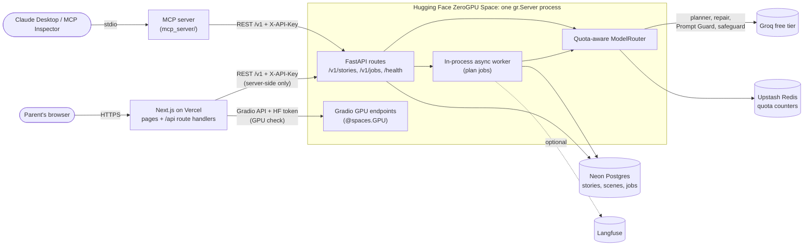
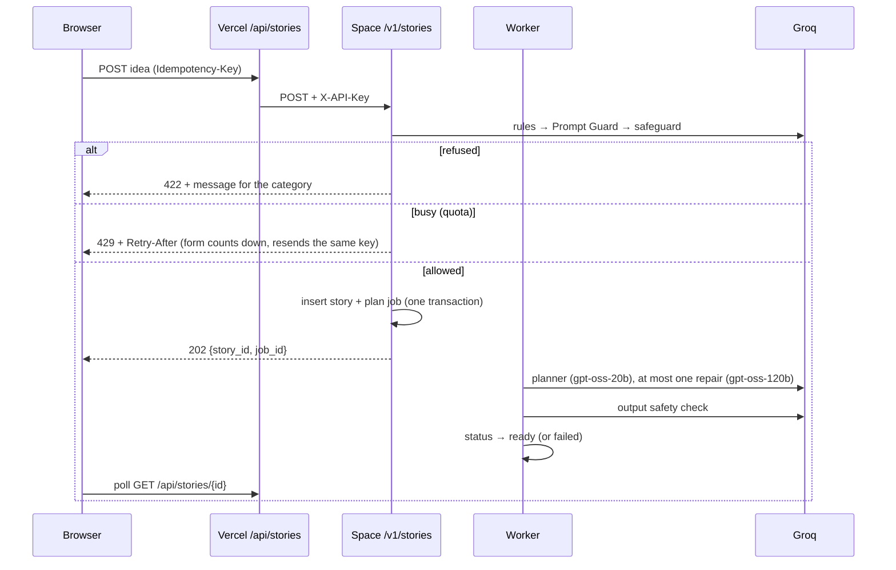

# StoryWeaver

A voice-first, illustrated children's audiobook generator (text ↔ image ↔ speech) for ages 4–6.
A parent types a story idea. StoryWeaver checks that the idea is safe, plans a 5–6 page bedtime story with an
LLM, checks the finished story again, and shows it as a picture book.

StoryWeaver is also a learning project. It covers an MCP server, quota-aware LLM routing, child-safety
guardrails, data collection, fine-tuning, RAG and system design, built version by version on free tiers.
[`plan.md`](plan.md) is the full design and roadmap and the source of truth for scope.

| | |
|---|---|
| **Live app** | https://storyweaver-eight-woad.vercel.app |
| **Backend (HF ZeroGPU Space)** | https://gaggaranushka-storyweaver.hf.space ([Space page](https://huggingface.co/spaces/gaggaranushka/storyweaver)) |
| **Current release** | `v1.0.2` (13 Nov 2026) |

---

## Contents

1. [Status](#status)
2. [Features (V1)](#features-v1)
3. [Architecture](#architecture)
4. [Repository structure](#repository-structure)
5. [API](#api)
6. [MCP server](#mcp-server)
7. [Tech stack](#tech-stack)
8. [Running locally](#running-locally)
9. [Testing](#testing)
10. [Deployment and releases](#deployment-and-releases)
11. [Configuration](#configuration)
12. [Safety and privacy](#safety-and-privacy)
13. [Roadmap](#roadmap)

---

## Status

| Version | What | Status | Tag |
|---|---|---|---|
| V0 | Foundations and deployment spike (ZeroGPU + Vercel + Groq end to end) | ✅ live | `v0.0.1`–`v0.0.5` |
| V1 | Text storyteller + MCP server v1 | ✅ live, all exit criteria met | `v1.0.0` |
| V1.1 | Friendlier guardrails (brand ideas adapted, refusal message per category, 30-word scene minimum) | ✅ live | `v1.0.1` |
| V1.0.2 | Busy ideas wait and resubmit automatically; Next.js 16.4.3 security fix | ✅ live | `v1.0.2` |
| V2 | Talking storybook (speech ↔ text) | ⏭ next | — |
| V3–V10 | Images, RAG, vision, fine-tuning, alignment, interactivity, production hardening, polish | planned | — |

**V1 exit criteria (all met):**
- A story idea becomes a safe, readable story live.
- The planner's JSON is valid for ≥ 95% of 50 prompts. The result was 50/50 (100%): 45 valid first time and 5 after one repair. See [`evaluation/results/json_validity_v1.md`](evaluation/results/json_validity_v1.md).
- The MCP server creates and reads stories from Claude Desktop and the MCP Inspector.
- Quota-aware routing falls back to another model when one runs low.

---

## Features (V1)

**Story generation**
- **One strict-JSON planner call** to Groq `openai/gpt-oss-20b`, using strict JSON-schema mode.
- **Validated story contract** (Pydantic):
  - 5–6 scenes, 30–120 words each;
  - Flesch-Kincaid grade ≤ 4;
  - every speaker is a declared character.
- **One repair call** to `openai/gpt-oss-120b` if validation fails, with specific advice (e.g. *"Add 4 more short sentences to it"*). If it still fails, the story fails with a clean error.
- **Async job flow:**
  - `POST /v1/stories` returns `202 {story_id, job_id}`.
  - A worker plans and checks the story; the UI polls until it is `ready` or `failed`.
  - Failed jobs retry up to 3 times with backoff.
- **Idempotency:** the same `Idempotency-Key` never creates two stories.

**Child safety (input and output)**
- **Input checks,** in this order:
  1. deterministic rules;
  2. **Prompt Guard 2** (prompt injection);
  3. **gpt-oss-safeguard** against [`safety/policy.md`](backend/src/storyweaver/safety/policy.md).
- **Output check:** the whole finished story is checked again before anyone can see it.
- **A clear refusal message for each category** (violence, real people, scary content, …).
- **Brand ideas are adapted, not refused** ([ADR-0002](docs/decisions/ADR-0002-redirect-brand-ideas.md)). "Tom and Jerry" becomes original characters, and the reader is told why.
- **Refused ideas are never stored.**

**Quota-aware routing**
- **Reservation before every Groq call:** Redis sliding-window counters mirror Groq's free-tier limits per organisation (requests and tokens, per minute and per day).
- **Fallback:** when a model is near its limit or returns 429, the router falls back to another model or cools down.

**Frontend**
- Prompt form with 5 or 6 pages, a progress screen that polls with backoff, and a page-by-page storybook (buttons and arrow keys).
- Friendly status messages, including a note explaining the safety-check wait.
- **Busy auto-wait (v1.0.2):** on a 429 the form counts down and resubmits with the same Idempotency-Key, with a Cancel link.
- A `/status` page showing backend, GPU and Groq health.

**MCP server**
- Tools `create_story`, `get_story` and `get_job_status`, the resource `story://{id}`, and the prompt `bedtime_story`.
- It is a thin adapter over the REST API.

**Operations**
- RFC 7807 errors, `X-Request-ID` on every request, and an `X-API-Key` on all `/v1` routes.
- CORS limited to the Vercel domain.
- Alembic migrations (expand-only) run on start-up.
- Optional Langfuse tracing; prompt and story content are not captured by default.

---

## Architecture



**How a story is made**



**Key design decisions**
- **ZeroGPU hybrid ([ADR-0001](docs/decisions/ADR-0001-zerogpu-fastapi.md)).**
  - ZeroGPU only works through Gradio, so the app is a `gr.Server` (a FastAPI subclass) started with `server.launch()`.
  - GPU work is exposed only as Gradio API endpoints. REST routes never call `@spaces.GPU` functions.
- **The API key never reaches the browser.** Only the Next.js route handlers hold it. On HF, CORS is not an access control (the proxy is permissive), so `X-API-Key` is.
- **Every external model sits behind an interface with a fallback** (`LLMClient`, `Tracer`, …), so local and production run the same code and only `.env` differs.
- **Groq free tier first** for every AI task it offers. Open-weight models only where Groq has none (images and embeddings in later versions).
- **No Celery:** it doesn't support Windows, so jobs live in Postgres (`FOR UPDATE SKIP LOCKED`) and run on an in-process async worker.

---

## Repository structure

```
storyweaver/
├── backend/            Python API + worker, deployed to the HF ZeroGPU Space
├── frontend/           Next.js app, deployed to Vercel
├── mcp_server/         FastMCP server (stdio), a thin adapter over /v1
├── evaluation/         V1 JSON-validity eval: prompts, script, results
├── infra/              docker-compose for the full local stack
├── scripts/            local smoke test
├── docs/               ADRs, Groq limits, release checklist
├── .github/            CI and Space deploy workflows
├── plan.md             design, research and roadmap (source of truth)
└── CLAUDE.md           condensed rules for AI coding assistants
```

### Root

| File | Description |
|---|---|
| `plan.md` | Full design: requirements, models, architecture, data, training, and the V0–V10 roadmap with exit criteria |
| `CLAUDE.md` | Condensed project rules and commands for AI assistants |
| `.env.example` | Template for the root `.env` used by Docker compose and the backend (never commit `.env`) |
| `.gitattributes` | Forces LF line endings (code runs in Linux containers); `.ps1` stays CRLF |
| `.gitignore` | Secrets, caches, build output, data/model files, local notes |
| `.pre-commit-config.yaml` | ruff and mypy (from the backend's locked env) and detect-secrets |
| `.secrets.baseline` | detect-secrets baseline |

### `backend/`

| Path | Description |
|---|---|
| `app.py` | Space entrypoint: runs `alembic upgrade head`, builds the `gr.Server` and calls `server.launch()` (never `uvicorn.run`) |
| `pyproject.toml` / `uv.lock` | uv project (`package = false`; Python 3.12; `exclude-newer` pins resolution to releases ≥ 2 weeks old) |
| `README.md` | Hugging Face Space card (front matter: SDK, Gradio version, hardware) |
| `Dockerfile` / `.dockerignore` | Local mirror of the Space runtime (Python 3.12.12, CUDA torch) |
| `alembic.ini` | Alembic config; the DB URL comes from `DATABASE_URL` |
| `migrations/env.py` | Async Alembic environment |
| `migrations/script.py.mako` | Template for new migrations |
| `migrations/versions/0001_initial_v1_tables.py` | `stories`, `characters`, `scenes`, `jobs` |
| `migrations/versions/0002_story_adaptation.py` | `stories.adaptation` (V1.1, expand-only) |

**`backend/src/storyweaver/`**

| Path | Description |
|---|---|
| `config.py` | `Settings`: all runtime configuration from env vars / `.env` |
| `services.py` | Composition root: builds the DB, Redis, router, LLM clients, guards, planner and worker; tears them down |
| `diagnostics.py` | V0 spike checks: `@spaces.GPU` matmul and a Groq round trip |
| `api/main.py` | `StoryWeaverServer` (a `gr.Server` that skips Gradio's CORS so ours is the only policy), app factory, lifespan, routers |
| `api/deps.py` | Dependencies: settings, `X-API-Key` check (`api_key_is_valid`, constant-time) |
| `api/errors.py` | RFC 7807 `application/problem+json` error handlers |
| `api/middleware.py` | `X-Request-ID`: accepted if valid, otherwise generated; echoed on every response |
| `api/gpu_endpoints.py` | Gradio API endpoints for GPU work (`gpu_check`), each checking the API key |
| `api/routers/health.py` | `/health/live` and `/health/ready` (database, Redis, worker) |
| `api/routers/stories.py` | `POST /v1/stories`, `GET /v1/stories/{id}`, `GET /v1/jobs/{id}` |
| `api/routers/diagnostics.py` | `POST /v1/echo` and `GET /v1/groq-check` |
| `domain/story.py` | Story domain model and content rules (scene count, words per scene, readability, character IDs) |
| `domain/readability.py` | Flesch-Kincaid grade, with no NLP dependency |
| `llm/client.py` | Provider-neutral `LLMClient` interface and errors |
| `llm/schemas.py` | What the planner returns, and the strict JSON Schema sent to Groq |
| `llm/planner.py` | Story planner: one strict-JSON call, then at most one repair call to the teacher model |
| `llm/prompts/planner_system.md` | Planner system prompt |
| `llm/prompts/planner_repair.md` | Repair prompt (lists the problems to fix) |
| `adapters/groq_llm.py` | Groq `LLMClient` (strict JSON schema; 429 → `LLMRateLimitedError` with Retry-After) |
| `adapters/langfuse_tracer.py` | Langfuse `Tracer` (used only when keys are set) |
| `routing/quotas.py` | Groq free-tier limits per model (config-driven; see `docs/groq-limits.md`) |
| `routing/store.py` | Sliding-window quota counters: a Redis Lua script, and an in-memory store for tests |
| `routing/router.py` | `ModelRouter.reserve()`: picks the first candidate with quota, plus cooldowns after 429s |
| `routing/llm.py` | `LLMClient` wrapper that routes every call through the router with fallbacks |
| `safety/rules.py` | Stage 1 input rules: fast, deterministic, deliberately narrow |
| `safety/guards.py` | `InputGuard` (rules → Prompt Guard → safeguard), `OutputGuard`, per-category messages |
| `safety/policy.md` | The policy gpt-oss-safeguard checks ideas and stories against |
| `orchestrator/story_service.py` | Use cases: accept a story (input check → insert → enqueue) and plan it (planner → output check → ready) |
| `jobs/queue.py` | Postgres job queue (`FOR UPDATE SKIP LOCKED`, DB clock, up to 3 attempts) |
| `jobs/worker.py` | In-process async worker: retries with backoff, deferral on quota, permanent failure codes |
| `storage/db.py` | Async SQLAlchemy engine and session factory |
| `storage/models.py` | SQLAlchemy models for the V1 tables |
| `storage/repositories.py` | `StoryRepository` (callers own transactions) |
| `observability/tracing.py` | `Tracer` interface and a no-op default; content is not captured by default |

**`backend/tests/`**

| Path | Description |
|---|---|
| `conftest.py`, `story_samples.py`, `db_helpers.py` | Shared fixtures, sample stories, Alembic helpers |
| `unit/` | Story rules, strict schema, planner and repair, Groq adapter, router and routed LLM, safety, tracing, GPU endpoints, health/echo, DB URL parsing |
| `integration/` | Real Postgres + Redis: storage, the Redis quota script, and POST → worker → GET (Groq stubbed) |
| `live/` | Opt-in tests against real Groq (planner and safety); they use real quota |

### `frontend/`

| Path | Description |
|---|---|
| `app/layout.tsx` | Root layout and metadata |
| `app/page.tsx` | Home page with the story form |
| `app/story/[id]/page.tsx` | Story page (progress, then the book) |
| `app/status/page.tsx` | Health page: backend, GPU and Groq |
| `app/globals.css` | Styles (light/dark tokens) |
| `app/api/stories/route.ts` | `POST /api/stories` → backend `POST /v1/stories` (validates input; forwards only the allowed fields and Idempotency-Key) |
| `app/api/stories/[id]/route.ts` | `GET /api/stories/{id}` → backend (UUID checked first) |
| `app/api/status/route.ts` | Aggregates the backend's health, Groq check and the GPU check |
| `components/StoryForm.tsx` | Prompt form: Idempotency-Key per idea, busy countdown and auto-resubmit, Cancel |
| `components/StoryViewer.tsx` | Polls the story with backoff and shows its progress, the book or the failure |
| `components/StoryBook.tsx` | One scene per page, with previous/next buttons and arrow keys |
| `lib/backend.ts` | **Server-only:** backend URL + API key, `forwardToBackend` (forwards Retry-After etc.) |
| `lib/gradio.ts` | **Server-only:** Gradio's two-step HTTP API for GPU endpoints, with the HF token |
| `lib/story-client.ts` | Browser-side calls to our own `/api` routes |
| `lib/story-logic.ts` | Pure, tested helpers: poll delays, messages, prompt validation, Retry-After parsing, auto-retry plan |
| `lib/story-types.ts` | TypeScript shapes mirroring the REST API |
| `tests/story-logic.test.ts` | Vitest unit tests |
| `next.config.ts`, `tsconfig.json`, `eslint.config.mjs`, `vitest.config.mts` | Tooling config |
| `package.json` / `package-lock.json` | Next.js 16.4.3, React 19 (resolve lockfile changes with Linux npm; see below) |
| `.env.example` | Server-side env template (`STORYWEAVER_API_URL`, `STORYWEAVER_API_KEY`, `HF_TOKEN`) |

### `mcp_server/`

| Path | Description |
|---|---|
| `server.py` | FastMCP server: tools, resource and prompt (stdio) |
| `client.py` | HTTP client for `/v1` (no business logic) |
| `tests/test_server.py` | Every tool, resource and prompt through the real MCP protocol in memory, with the API mocked |
| `README.md` | MCP setup, including the Claude Desktop config |
| `pyproject.toml` / `uv.lock` | Separate uv project |

### Other folders

| Path | Description |
|---|---|
| `evaluation/json_validity.py` | V1 exit-criterion eval: runs the planner on 50 prompts and checks schema + content rules |
| `evaluation/data/prompts_v1.txt` | The 50 eval prompts |
| `evaluation/results/json_validity_v1.{md,jsonl}` | Results: 50/50 valid |
| `infra/docker-compose.yml` | Local stack: API (GPU), web, Postgres + pgvector, Redis, SeaweedFS S3 (:8333) |
| `scripts/local_smoke.sh` | 37 end-to-end checks (incl. one real Whisper call) against the running stack; exits non-zero on failure |
| `docs/decisions/ADR-0001-zerogpu-fastapi.md` | Why the app is a `gr.Server` with Gradio GPU endpoints alongside REST |
| `docs/decisions/ADR-0002-redirect-brand-ideas.md` | Why brand ideas are adapted, not refused |
| `docs/decisions/ADR-0003-pyav-gpl-ffmpeg.md` | Why PyAV's GPL-built FFmpeg is acceptable server-side (never distributed) |
| `docs/groq-limits.md` | Groq free-tier limits per model, as configured in `routing/quotas.py` |
| `docs/release-v1.md` | V1 release checklist (accounts, secrets, order of deploys) |
| `.github/workflows/ci.yml` | CI: backend (ruff, mypy, unit + integration tests with Postgres/Redis, Space install check), frontend (lint, typecheck, test, build), MCP tests |
| `.github/workflows/deploy-backend.yml` | On a `v*` tag: CI, export `requirements.txt` from `uv.lock`, push `backend/` to the Space |
| `.github/scripts/deploy_space.py` | Uploads `backend/` to the Space with `huggingface_hub` |

---

## API

All `/v1` routes need `X-API-Key`. Errors are RFC 7807 `application/problem+json`. Every response carries
`X-Request-ID`. `/docs` exists only when `APP_ENV=local`.

| Method | Path | Description |
|---|---|---|
| `POST` | `/v1/stories` | Body `{prompt, age_band="4-6", num_scenes: 5\|6}`, optional `Idempotency-Key`. **202** `{story_id, job_id, status}`; **422** unsafe idea (`code: unsafe_input`, `category`, message); **429/503** safety check busy (`Retry-After`) |
| `GET` | `/v1/stories/{id}` | Status (`queued` → `planning` → `checking` → `ready` \| `failed`); content only when `ready`; `notice` if the idea was adapted |
| `GET` | `/v1/jobs/{id}` | Job status, attempts and next run time |
| `POST` | `/v1/echo` | Diagnostics |
| `GET` | `/v1/groq-check` | One small Groq call |
| `GET` | `/health/live`, `/health/ready` | No key; `ready` checks the database, Redis and the worker |
| Gradio | `/gradio_api/call/gpu_check` | GPU matmul check (two-step Gradio API, `X-API-Key` + HF token) |

---

## MCP server

| Kind | Name | Calls |
|---|---|---|
| tool | `create_story(prompt, age_band="4-6", num_scenes=5)` | `POST /v1/stories` |
| tool | `get_story(story_id)` | `GET /v1/stories/{id}` |
| tool | `get_job_status(job_id)` | `GET /v1/jobs/{id}` |
| resource | `story://{story_id}` | `GET /v1/stories/{id}` |
| prompt | `bedtime_story(favourite_animal, theme)` | — |

Setup, including the Claude Desktop config, is in [`mcp_server/README.md`](mcp_server/README.md).

---

## Tech stack

| Layer | Choice |
|---|---|
| Backend | Python 3.12, uv, Gradio `gr.Server` (FastAPI), SQLAlchemy 2 async + asyncpg, Alembic, Pydantic v2, redis-py |
| Hosting | Hugging Face **ZeroGPU** Gradio Space (backend), **Vercel Hobby** (frontend) |
| Frontend | Next.js 16 (App Router), React 19, TypeScript, Vitest |
| MCP | FastMCP (stdio; Streamable HTTP planned for V9) |
| LLMs (Groq free tier) | `openai/gpt-oss-20b` (planner), `openai/gpt-oss-120b` (repair), `meta-llama/llama-prompt-guard-2-22m`, `openai/gpt-oss-safeguard-20b` |
| Data | Neon Postgres (+ pgvector, from V4), Upstash Redis |
| Observability | Langfuse (optional) |
| Local | Docker compose: Postgres + pgvector, Redis, SeaweedFS S3 |
| Quality | ruff, mypy (strict), pytest, ESLint, pre-commit, detect-secrets, GitHub Actions |

Later versions add Cloudflare R2 (or another free S3 store), Grafana Cloud, MLflow, DVC + DagsHub and
Prefect. See [`plan.md`](plan.md).

---

## Running locally

**Prerequisites:** Docker Desktop (with GPU support for the API container), [uv](https://docs.astral.sh/uv/),
Node 24, and Git Bash on Windows for the smoke script.

```powershell
# 1. Secrets
copy .env.example .env                 # fill in STORYWEAVER_API_KEY, GROQ_API_KEY, POSTGRES_PASSWORD, S3 keys
copy frontend\.env.example frontend\.env.local

# 2. Full local stack: API (GPU) :7860, web :3000, Postgres :5432, Redis :6379, SeaweedFS S3 :8333
docker compose -f infra/docker-compose.yml --env-file .env up --build

# 3. Smoke test (Git Bash), 37 checks
bash scripts/local_smoke.sh .env
```

Open http://localhost:3000. The API docs are at http://localhost:7860/docs (local only).

**Running parts on their own**

```powershell
# backend/ (torch is CPU-only on Windows; use Docker for the GPU)
uv sync
uv run python app.py                   # :7860 (needs DATABASE_URL and REDIS_URL, e.g. the Docker ones)

# frontend/
npm ci
npm run dev                            # :3000

# mcp_server/
uv sync
uv run mcp dev server.py               # MCP Inspector
```

---

## Testing

```powershell
# backend/
uv run ruff check . ; uv run ruff format --check . ; uv run mypy
uv run pytest -m unit
# integration: needs the Docker Postgres + Redis (the test DB name must end in _test; it is dropped and recreated)
#   TEST_DATABASE_URL=postgresql+asyncpg://storyweaver:<password>@localhost:5432/storyweaver_test
#   REDIS_URL=redis://localhost:6379/15
uv run pytest -m "unit or integration"
# live (opt-in; uses real Groq quota)
uv run pytest -m live tests/live -s

# frontend/
npm run lint ; npm run typecheck ; npm test ; npm run build

# mcp_server/
uv run pytest

# evaluation, from the repo root (uses real Groq quota)
uv run --directory backend python ../evaluation/json_validity.py
```

**Current counts (v1.0.2):** backend 153 unit + integration tests, frontend 12 Vitest tests, MCP 13 tests,
and 33/33 smoke checks.

---

## Deployment and releases

| Target | Trigger |
|---|---|
| **Frontend (Vercel)** | A push to `main`. The Vercel project root is `frontend/` |
| **Backend (HF Space)** | A pushed `v*` tag runs CI, then `deploy-backend.yml` uploads `backend/`. If `backend/` hasn't changed, no new Space commit is made |

**Release process** (every version):
1. **Local gate:** backend, frontend and MCP tests; Docker stack + smoke test (37/37); the version's exit criteria checked by hand.
2. **CI:** push `dev-vN` and wait for CI to pass.
3. **Backend:** tag `vX.Y.Z` and push the tag, then check the Space:
   - runtime `RUNNING`;
   - `/health/ready` all ok;
   - unauthenticated `POST /v1/stories` returns 401;
   - `/docs` returns 404.
4. **Frontend:** fast-forward `main` to the tagged commit (Vercel deploys), then do a live check.

**Rollback:** Vercel Instant Rollback for the frontend; redeploy the previous tag for the backend. Migrations
are expand-only, so a rollback never needs a down-migration.

**Lockfiles:** resolve `frontend/package-lock.json` changes with **Linux** npm, because Vercel and Docker
run Linux. A lock resolved on Windows can drop Linux-only optional packages, and `npm ci` then fails:

```bash
docker run --rm -v "<frontend dir>:/w" -w /w node:24-alpine \
  npm install <pkg>@<version> --package-lock-only --ignore-scripts
```

---

## Configuration

| Variable | Where | Purpose |
|---|---|---|
| `STORYWEAVER_API_KEY` | Space **Secret**, Vercel env, `.env` | Shared key for `/v1` and the GPU endpoints |
| `GROQ_API_KEY` | Space **Secret**, `.env` | Groq free tier |
| `APP_ENV` | Space Variable (`prod`), `.env` (`local`) | `local` enables `/docs` |
| `ALLOWED_ORIGINS` | Space Variable | The Vercel domain only (no trailing slash) |
| `DATABASE_URL`, `REDIS_URL` | Space Secrets / compose | Neon Postgres, Upstash Redis |
| `LLM_PLANNER`, `LLM_TEACHER` | optional | Default `groq:openai/gpt-oss-20b`, `groq:openai/gpt-oss-120b` |
| `QUOTA_SAFETY_MARGIN` | optional | Fraction of each Groq limit the router may use (default 0.9) |
| `LANGFUSE_PUBLIC_KEY`, `LANGFUSE_SECRET_KEY` | optional | Turn tracing on |
| `STORYWEAVER_API_URL` | Vercel env | The `*.hf.space` URL (not `huggingface.co/spaces/...`) |
| `HF_TOKEN` | Vercel env | Read-only HF token; ZeroGPU charges GPU quota to it |
| `POSTGRES_PASSWORD`, `S3_ACCESS_KEY_ID`, `S3_SECRET_ACCESS_KEY` | `.env` | Local Docker stack |

Secrets go only in HF Space **Secrets** (Variables are public) and Vercel env. Never commit `.env`.

---

## Safety and privacy

- **Two checkpoints:** every idea is checked before a story is created, and every finished story is checked before it is shown. Content is hidden until the output check passes.
- **Refused ideas are never stored.** The input check runs before anything is written to the database.
- **No tracked content in traces:** Langfuse doesn't capture prompts or stories unless `LANGFUSE_CAPTURE_CONTENT=true`.
- **No secrets in the browser:** the API key exists only in server-side code (Vercel route handlers, the MCP server).
- **Allowed models only:** no gated, non-commercial or GPL models (see `plan.md` §2.2).
- **Voice (from V2):** audio will never be stored or logged.

---

## Roadmap

| Version | Theme | Highlights |
|---|---|---|
| **V2** | Talking storybook | Whisper STT (Groq, faster-whisper fallback), Orpheus TTS with a Kokoro fallback, S3 blob storage, mic recording, privacy docs, Playwright |
| V3 | Illustrated storybook | Image generation on ZeroGPU, consistent characters |
| V4 | Story memory | RAG with pgvector |
| V5 | Smart eyes | Image → text, image → speech |
| V6 | My own storyteller | Fine-tuning I and distillation (Qwen3-4B) |
| V7 | Aligned and styled | Fine-tuning II |
| V8 | Interactive and safe | Interactivity; red-team suite as a CI gate |
| V9 | Production-grade | MCP over Streamable HTTP, observability, hardening |
| V10 | Polish and portfolio | |

Each version's tasks and exit criteria are in [`plan.md`](plan.md) §10.
