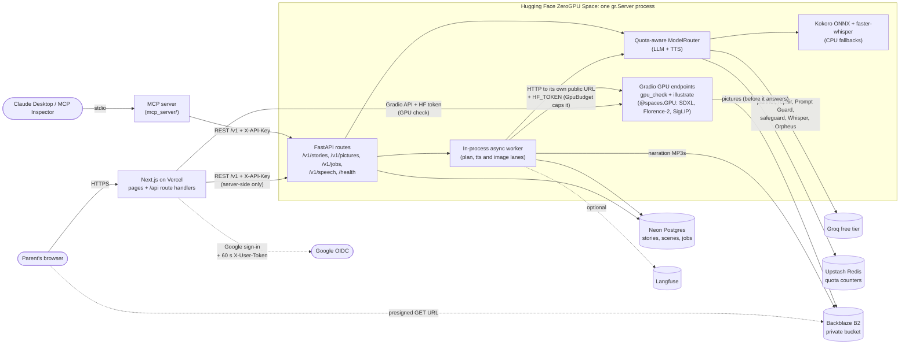
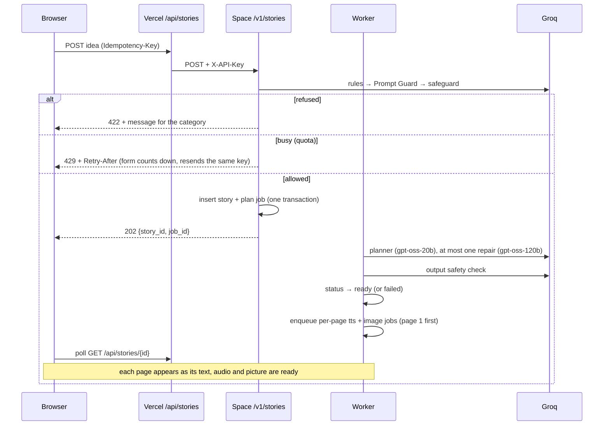

# StoryWeaver

A voice-first, illustrated children's audiobook generator (text ↔ image ↔ speech) for ages 4–6.
A parent signs in, then types **or speaks** a story idea. StoryWeaver checks that the idea is safe, plans a 5–6
page bedtime story with an LLM, checks the finished story again, **draws a picture for every page** (the same
character on each one) and shows it as a picture book **that reads itself aloud**, with a different voice for
each character.

StoryWeaver is also a learning project. It covers an MCP server, quota-aware LLM routing, child-safety
guardrails, data collection, fine-tuning, RAG and system design, built version by version on free tiers.
[`plan.md`](plan.md) is the full design and roadmap and the source of truth for scope.

| | |
|---|---|
| **Live app** | https://storyweaver-eight-woad.vercel.app |
| **Backend (HF ZeroGPU Space)** | https://gaggaranushka-storyweaver.hf.space ([Space page](https://huggingface.co/spaces/gaggaranushka/storyweaver)) |
| **Current release** | `v3.0.0` (21 Nov 2026). V4 (story memory) is in progress on the `dev-v4` branch |

---

## Contents

1. [Status](#status)
2. [Features](#features)
3. [Architecture](#architecture)
4. [Repository structure](#repository-structure)
5. [API](#api)
6. [MCP server](#mcp-server)
7. [Tech stack](#tech-stack)
8. [Running locally](#running-locally)
9. [Testing](#testing)
10. [Deployment and releases](#deployment-and-releases)
11. [Configuration](#configuration)
12. [Safety and privacy](#safety-and-privacy)
13. [Roadmap](#roadmap)

---

## Status

| Version | What | Status | Tag |
|---|---|---|---|
| V0 | Foundations and deployment spike (ZeroGPU + Vercel + Groq end to end) | ✅ live | `v0.0.1`–`v0.0.5` |
| V1 | Text storyteller + MCP server v1 | ✅ live, all exit criteria met | `v1.0.0` |
| V1.1 | Friendlier guardrails (brand ideas adapted, refusal message per category, 30-word scene minimum) | ✅ live | `v1.0.1` |
| V1.0.2 | Busy ideas wait and resubmit automatically; Next.js 16.4.3 security fix | ✅ live | `v1.0.2` |
| V2 | Talking storybook (speech ↔ text): voice input, narrated pages, object storage | ✅ live, all exit criteria met | `v2.0.3` |
| V3 | Illustrated storybook (text/speech → image): pictures, consistent characters, sign-in, MCP `illustrate` | ✅ live; one exit criterion missed (first page 21.5 s against a 15 s target) | `v3.0.0` |
| V4 | Story memory (RAG with pgvector) | 🚧 in progress (`dev-v4`) | — |
| V5–V10 | Vision, fine-tuning, alignment, interactivity, production hardening, polish | planned | — |

**V1 exit criteria (all met):**
- A story idea becomes a safe, readable story live.
- The planner's JSON is valid for ≥ 95% of 50 prompts. The result was 50/50 (100%): 45 valid first time and 5 after one repair. See [`evaluation/results/json_validity_v1.md`](evaluation/results/json_validity_v1.md).
- The MCP server creates and reads stories from Claude Desktop and the MCP Inspector.
- Quota-aware routing falls back to another model when one runs low.

**V2 exit criteria (all met):**
- A spoken prompt becomes a narrated story, live.
- The Orpheus → Kokoro fallback was demonstrated by forcing the daily quota to zero: the story still narrated, on Kokoro, while a request that *named* an Orpheus voice correctly returned 429 instead of silently switching voice.

The V2 release — including the two failed tags and the post-release outage, with causes and fixes — is
written up in [`docs/release-v2.md`](docs/release-v2.md).

**V3 exit criteria (live on 21 Nov 2026, `v3.0.0`):**
- ✅ **Character recognisable:** the same hedgehog on 5 of 5 SDXL pages.
- ✅ **Placeholder fallback works:** with `IMAGE_ENGINE` unset all 5 pages fell back to placeholders and the story still finished.
- ❌ **First page in ≤ 15 s: not met.** It took **21.5 s** on the live Space: 10.2 s for the text (including one planner repair) plus 9.4 s for the first GPU picture. It was released anyway, because it is latency and not a defect. The follow-up (draw page 1 as soon as its text exists, and cut planner repairs) is in V4.

The release steps, and the lesson from a first live story that made only placeholders (the Space was missing
its V3 settings), are in [`docs/release-v3.md`](docs/release-v3.md).

---

## Features

**Story generation**
- **One strict-JSON planner call** to Groq `openai/gpt-oss-20b`, using strict JSON-schema mode.
- **Validated story contract** (Pydantic):
  - 5–6 scenes, 30–120 words each;
  - Flesch-Kincaid grade ≤ 4;
  - every speaker is a declared character, or one of at most 2 undeclared guests (a one-line owl) who
    appear in at most 2 scenes and get their own voice but no fixed look.
- **One repair call** to `openai/gpt-oss-120b` if validation fails, with specific advice (e.g. *"Add 4 more short sentences to it"*). If it still fails, the story fails with a clean error.
- **Async job flow:**
  - `POST /v1/stories` returns `202 {story_id, job_id}`.
  - A worker plans and checks the story; the UI polls until it is `ready` or `failed`.
  - Failed jobs retry up to 3 times with backoff.
- **Idempotency:** the same `Idempotency-Key` never creates two stories.

**Child safety (input and output)**
- **Input checks,** in this order:
  1. deterministic rules;
  2. **Prompt Guard 2** (prompt injection);
  3. **gpt-oss-safeguard** against [`safety/policy.md`](backend/src/storyweaver/safety/policy.md).
- **Output check:** the whole finished story is checked again before anyone can see it.
- **A clear refusal message for each category** (violence, real people, scary content, …).
- **Brand ideas are adapted, not refused** ([ADR-0002](docs/decisions/ADR-0002-redirect-brand-ideas.md)). "Tom and Jerry" becomes original characters, and the reader is told why.
- **Refused ideas are never stored.**

**Quota-aware routing**
- **Reservation before every Groq call:** Redis sliding-window counters mirror Groq's free-tier limits per organisation (requests and tokens, per minute and per day).
- **Fallback:** when a model is near its limit or returns 429, the router falls back to another model or cools down.

**Speech (V2)**
- **Voice input:** the parent records an idea in the browser (MediaRecorder) and it is transcribed by Groq `whisper-large-v3-turbo`, with **faster-whisper** on the Space's CPU as the fallback. `STT_ENGINE=local` keeps voice off third-party servers entirely.
- **Audio never touches disk.** The recording is posted as a raw request body (not multipart, which Starlette spools to a temp file), held in memory with a 10 MB cap, decoded in-process with PyAV, transcribed and dropped. Neither the audio nor the transcript is logged.
- **Rejected before transcription:** not audio, over 10 MB, longer than 60 s, or silent — each with a message a parent can act on.
- **Narration:** every page is read aloud, **one voice per character** assigned deterministically from the story id, so a character sounds the same throughout.
- **Two TTS engines behind one interface:** Groq **Orpheus** while its daily quota lasts, then **Kokoro** (ONNX, on CPU). The engine is chosen **once per story** so voices never mix mid-story.
- **Audio stored in Backblaze B2** ([ADR-0004](docs/decisions/ADR-0004-backblaze-b2-object-storage.md)) in a private bucket, served to the browser as presigned GET URLs that expire.
- **Stories expire after 30 days** and can be deleted on demand — rows and audio together.

**Pictures (V3)**
- **One picture per page**, drawn in a fixed picture-book style. Without that prefix the planner's prompts came out as photographs.
- **Three image engines behind one interface** (`IMAGE_ENGINE`): **SDXL** base 1.0 on ZeroGPU in production, **SD 1.5** on your own GPU in the local Docker stack, and a **placeholder** used when there is no GPU or the day's GPU budget is spent.
- **The same character on every page:** the main character's description goes early in every prompt, the seed is the character's seed plus the page number, and page 1's picture is passed to later pages as an **IP-Adapter** reference (strength 0.4).
- **Picture self-check:** Florence-2 captions each picture and SigLIP scores it against the character. A picture with an unsafe word in its caption, or that misses its character, is redrawn up to 2 times with a new seed. If none is safe it becomes a placeholder.
- **The worker has no caller to charge**, so it calls the Space's own `illustrate` Gradio endpoint over its public URL with an `HF_TOKEN`, and the endpoint stores the picture before answering (see Key design decisions).
- **Content-addressed cache:** a key hashing *every* generation setting (model revision, size, sampler, steps, reference, …) lives in B2 under the story's prefix, so a retry after a crash records the stored picture instead of redrawing it.
- **Quick pictures:** "draw a purple dragon", typed or spoken, makes a one-page story of kind `picture` (`POST /v1/pictures`). The request phrase is stripped by rules, with no LLM tokens, and the words pass the same safety checks as a story.
- **Limits:** a per-parent cap on stories (5 an hour, 15 a day) and on pictures (10 an hour, 30 a day), plus a **daily GPU budget** (900 GPU-seconds across everyone) after which pages get placeholders.

**Accounts and sharing (V3)**
- **Google sign-in on the Vercel side only** (OIDC code + PKCE, scope `openid`). The session cookie never reaches the backend.
- **Stories are private to their owner.** Every story route is scoped to an owner, and a story that isn't yours answers 404. The MCP server and scripts, which have no user token, act as a separate "operator" owner.
- **Share links** are read-only, stateless (HMAC-signed) and expire 15 minutes after creation. They are never renewed.
- A **My stories** list, and delete on demand.

**Frontend**
- Prompt form with 5 or 6 pages, a progress screen that polls with backoff, and a page-by-page storybook (buttons and arrow keys). A **story / picture** switch on the home form.
- Friendly status messages, including a note explaining the safety-check wait.
- **Busy auto-wait (v1.0.2):** on a 429 the form counts down and resubmits with the same Idempotency-Key, with a Cancel link.
- **Mic recorder and a per-page audio player (V2)**, with a note beside the mic explaining what happens to the recording, and a `/privacy` page.
- A `/status` page showing backend, GPU and Groq health.

**MCP server**
- Tools `create_story`, `get_story`, `get_job_status`, **`transcribe` and `narrate` (V2)** and **`illustrate` (V3)**; resources `story://{id}` and **`voices://list`**; the prompt `bedtime_story`.
- `illustrate(prompt, story_id?, character_id?)` waits up to 2 minutes and returns the picture as MCP image content plus a saved PNG. With a story and character it draws that character again, keeping its look.
- It is a thin adapter over the REST API.

**Data collection (started in V3)**
- `data_pipeline/flows/synth_generate.py` generates synthetic training data for the V6 fine-tune. It runs the backend's own planner with `gpt-oss-120b` as teacher, so every kept record passed live validation. It is resumable and paced by the same quota code as the live app. It makes about 26 records a day, so the 5,000-record target would take roughly 6 months on one teacher (see [`docs/data-cards/synthetic-planner-sft.md`](docs/data-cards/synthetic-planner-sft.md)).

**Operations**
- RFC 7807 errors, `X-Request-ID` on every request, and an `X-API-Key` on all `/v1` routes.
- CORS limited to the Vercel domain.
- Alembic migrations (expand-only) run on start-up.
- **An idle worker lets Neon sleep:** each job lane sleeps until it is woken (a story was queued, or a job finished) or its next deferred job is due, and the expiry sweep runs every 6 hours.
- Optional Langfuse tracing; prompt and story content are not captured by default.

---

## Architecture



**How a story is made**



**Key design decisions**
- **ZeroGPU hybrid ([ADR-0001](docs/decisions/ADR-0001-zerogpu-fastapi.md)).**
  - ZeroGPU only works through Gradio, so the app is a `gr.Server` (a FastAPI subclass) started with `server.launch()`.
  - GPU work is exposed only as Gradio API endpoints. REST routes never call `@spaces.GPU` functions.
- **The API key never reaches the browser.** Only the Next.js route handlers hold it. On HF, CORS is not an access control (the proxy is permissive), so `X-API-Key` is.
- **Every external model sits behind an interface with a fallback** (`LLMClient`, `Tracer`, …), so local and production run the same code and only `.env` differs.
- **Groq free tier first** for every AI task it offers. Open-weight models only where Groq has none (images today, embeddings from V4).
- **The worker draws through the Space's own Gradio endpoint (V3).** ZeroGPU charges GPU time to a *caller*, and a background job has none. So the worker calls the Space's own `illustrate` endpoint over its public `*.hf.space` URL with an `HF_TOKEN`, and that account's quota pays. The endpoint stores the picture before it answers. `GpuBudget` caps the day's GPU-seconds, and `GET /v1/gpu-route-check` tests the route. Proven on a private test Space before release.
- **Sign-in lives on Vercel only (V3).** The backend never sees a session cookie. Vercel signs a 60-second `X-User-Token`, and the backend scopes every story route to that owner.
- **One worker lane per job kind (V2).** `plan`, `tts` and `image` jobs each have their own claim loop, so a narration paused by Orpheus's per-minute pacing never blocks a plan job.
- **No Celery:** it doesn't support Windows, so jobs live in Postgres (`FOR UPDATE SKIP LOCKED`) and run on an in-process async worker.
- **One TTS engine per story, booked up front.** Orpheus's free tier is about one story a day, so the router reserves a story's *whole* narration budget in a single atomic reservation, or picks Kokoro. A story never starts on Orpheus unless it can finish on Orpheus.
- **A misconfigured audio store degrades, it doesn't crash** (learned the hard way in `v2.0.1`): stories still work without narration, and `/health/ready` reports `audio_storage: misconfigured`.

---

## Repository structure

```
storyweaver/
├── backend/            Python API + worker, deployed to the HF ZeroGPU Space
├── frontend/           Next.js app, deployed to Vercel
├── mcp_server/         FastMCP server (stdio), a thin adapter over /v1
├── data_pipeline/      Synthetic training-data generator (more flows arrive in V4)
├── evaluation/         V1 JSON-validity eval: prompts, script, results
├── infra/              docker-compose for the full local stack
├── scripts/            local smoke test
├── docs/               ADRs, Groq limits, release checklists, data cards
├── .github/            CI and Space deploy workflows
├── plan.md             design, research and roadmap (source of truth)
└── CLAUDE.md           condensed rules for AI coding assistants
```

### Root

| File | Description |
|---|---|
| `plan.md` | Full design: requirements, models, architecture, data, training, and the V0–V10 roadmap with exit criteria |
| `CLAUDE.md` | Condensed project rules and commands for AI assistants |
| `.env.example` | Template for the root `.env` used by Docker compose and the backend (never commit `.env`) |
| `.gitattributes` | Forces LF line endings (code runs in Linux containers); `.ps1` stays CRLF |
| `.gitignore` | Secrets, caches, build output, data/model files, local notes |
| `.pre-commit-config.yaml` | ruff and mypy (from the backend's locked env) and detect-secrets |
| `.secrets.baseline` | detect-secrets baseline |

### `backend/`

| Path | Description |
|---|---|
| `app.py` | Space entrypoint: runs `alembic upgrade head`, builds the `gr.Server` and calls `server.launch()` (never `uvicorn.run`) |
| `pyproject.toml` / `uv.lock` | uv project (`package = false`; Python 3.12; `exclude-newer` pins resolution to releases ≥ 2 weeks old) |
| `README.md` | Hugging Face Space card (front matter: SDK, Gradio version, hardware) |
| `Dockerfile` / `.dockerignore` | Local mirror of the Space runtime (Python 3.12.12, CUDA torch) |
| `alembic.ini` | Alembic config; the DB URL comes from `DATABASE_URL` |
| `migrations/env.py` | Async Alembic environment |
| `migrations/script.py.mako` | Template for new migrations |
| `migrations/versions/0001_initial_v1_tables.py` | `stories`, `characters`, `scenes`, `jobs` |
| `migrations/versions/0002_story_adaptation.py` | `stories.adaptation` (V1.1, expand-only). V2 added **no** migration: narration reuses columns `0001` created |
| `migrations/versions/0003_scene_image_status.py`, `0004_story_owner.py`, `0005_story_kind.py` | `scenes.image_status`; `stories.owner_id`; `stories.kind` (`story` or `picture`) (V3, all expand-only) |
| `scripts/` | Measuring probes, not part of the app: `consistency_probe.py` (character consistency settings), `gpu_fit_probe.py`, `illustrate_probe.py` (the ZeroGPU route and SDXL on a test Space), `measure_planner.py` (repair counts) |

**`backend/src/storyweaver/`**

| Path | Description |
|---|---|
| `config.py` | `Settings`: all runtime configuration from env vars / `.env` |
| `services.py` | Composition root: builds the DB, Redis, router, LLM clients, guards, planner and worker; tears them down |
| `diagnostics.py` | V0 spike checks: `@spaces.GPU` matmul and a Groq round trip |
| `api/main.py` | `StoryWeaverServer` (a `gr.Server` that skips Gradio's CORS so ours is the only policy), app factory, lifespan, routers |
| `api/deps.py` | Dependencies: settings, `X-API-Key` check (`api_key_is_valid`, constant-time) |
| `api/errors.py` | RFC 7807 `application/problem+json` error handlers |
| `api/middleware.py` | `X-Request-ID`: accepted if valid, otherwise generated; echoed on every response |
| `api/gpu_endpoints.py` | Gradio API endpoints for GPU work (`gpu_check`), each checking the API key |
| `api/routers/health.py` | `/health/live` and `/health/ready` (database, Redis, worker, audio storage) |
| `api/routers/stories.py` | `POST`/`GET /v1/stories`, `GET` and `DELETE /v1/stories/{id}`, `POST /v1/stories/{id}/share`, `GET /v1/shared/{token}`, `GET /v1/jobs/{id}` |
| `auth/user_token.py`, `auth/share_links.py` | Verifying the signed-in parent's `X-User-Token`; 15-minute share links (V3) |
| `imaging/generator.py`, `imaging/params.py` | The `ImageGenerator` interface; `GenerationParams`, whose every field goes into the cache key, and the fixed picture-book style prefix |
| `imaging/sd15.py`, `imaging/sdxl.py`, `imaging/placeholder.py` | The engines: SD 1.5 (local GPU), SDXL (ZeroGPU), and the placeholder fallback |
| `imaging/picture_check.py` | Florence-2 caption + SigLIP score; unsafe-word and character checks, up to 2 redraws |
| `imaging/gpu_drawing.py`, `imaging/remote.py` | `draw_on_gpu` (the `@spaces.GPU` function), and the worker's HTTP client for the Space's own `illustrate` endpoint |
| `orchestrator/illustration_jobs.py` | The per-page `image` job: cache check, draw, store, record; waits for page 1 as the reference |
| `orchestrator/picture_request.py` | Turns "can you draw me a purple dragon, please?" into "a purple dragon" with rules, not an LLM |
| `routing/limits.py` | `VisitorLimiter` (stories and pictures per owner) and `GpuBudget` (the day's GPU-seconds) |
| `api/routers/speech.py` | `POST /v1/speech/transcribe` (raw audio body, never multipart), `POST /v1/speech/narrate`, `GET /v1/speech/voices` |
| `speech/audio_utils.py` | In-memory decode to 16 kHz mono with PyAV; size, duration and silence checks |
| `speech/stt.py` / `speech/tts.py` | `STTEngine` / `TTSEngine` interfaces and their errors |
| `speech/voices.py` | Voice catalogue per engine, and deterministic per-character voice assignment |
| `adapters/groq_whisper.py` / `adapters/faster_whisper.py` | Speech-to-text: Groq, and the CPU fallback |
| `adapters/groq_orpheus.py` / `adapters/kokoro_tts.py` | Text-to-speech: Groq Orpheus (≤ 200-character chunks), and Kokoro ONNX on CPU |
| `routing/tts.py` | Books a story's whole Orpheus budget at once or picks Kokoro; paces Orpheus per minute |
| `orchestrator/narration.py` | Turns a scene's lines into one MP3: per-speaker voices, pauses, concatenation |
| `orchestrator/narration_jobs.py` | The per-scene `tts` job: synthesise, upload, record the key; falls back to Kokoro |
| `orchestrator/story_deletion.py` | On-demand delete and the 30-day expiry sweep (rows and audio together) |
| `storage/blob.py` | `BlobStore` and one `S3BlobStore` (B2 in production, SeaweedFS locally), presigned GET URLs |
| `api/routers/diagnostics.py` | `POST /v1/echo` and `GET /v1/groq-check` |
| `domain/story.py` | Story domain model and content rules (scene count, words per scene, readability, character IDs) |
| `domain/readability.py` | Flesch-Kincaid grade, with no NLP dependency |
| `llm/client.py` | Provider-neutral `LLMClient` interface and errors |
| `llm/schemas.py` | What the planner returns, and the strict JSON Schema sent to Groq |
| `llm/planner.py` | Story planner: one strict-JSON call, then at most one repair call to the teacher model |
| `llm/prompts/planner_system.md` | Planner system prompt |
| `llm/prompts/planner_repair.md` | Repair prompt (lists the problems to fix) |
| `adapters/groq_llm.py` | Groq `LLMClient` (strict JSON schema; 429 → `LLMRateLimitedError` with Retry-After) |
| `adapters/langfuse_tracer.py` | Langfuse `Tracer` (used only when keys are set) |
| `routing/quotas.py` | Groq free-tier limits per model (config-driven; see `docs/groq-limits.md`) |
| `routing/store.py` | Sliding-window quota counters: a Redis Lua script, and an in-memory store for tests |
| `routing/router.py` | `ModelRouter.reserve()`: picks the first candidate with quota, plus cooldowns after 429s |
| `routing/llm.py` | `LLMClient` wrapper that routes every call through the router with fallbacks |
| `safety/rules.py` | Stage 1 input rules: fast, deterministic, deliberately narrow |
| `safety/guards.py` | `InputGuard` (rules → Prompt Guard → safeguard), `OutputGuard`, per-category messages |
| `safety/policy.md` | The policy gpt-oss-safeguard checks ideas and stories against |
| `orchestrator/story_service.py` | Use cases: accept a story (input check → insert → enqueue) and plan it (planner → output check → ready) |
| `jobs/queue.py` | Postgres job queue (`FOR UPDATE SKIP LOCKED`, DB clock, up to 3 attempts) |
| `jobs/worker.py` | In-process async worker: retries with backoff, deferral on quota, permanent failure codes |
| `storage/db.py` | Async SQLAlchemy engine and session factory |
| `storage/models.py` | SQLAlchemy models for the V1 tables |
| `storage/repositories.py` | `StoryRepository` (callers own transactions) |
| `observability/tracing.py` | `Tracer` interface and a no-op default; content is not captured by default |

**`backend/tests/`**

| Path | Description |
|---|---|
| `conftest.py`, `story_samples.py`, `db_helpers.py` | Shared fixtures, sample stories, Alembic helpers |
| `unit/` | Story rules, strict schema, planner and repair, Groq adapter, router and routed LLM, safety, tracing, GPU endpoints, health/echo, DB URL parsing, audio decoding, the speech and narration APIs, voices, the blob store, and (V3) user tokens and share links, the image engines and cache key, the picture check, the remote GPU client, limits, picture requests and the synthetic-data generator |
| `integration/` | Real Postgres + Redis: storage, the Redis quota script, POST → worker → GET (Groq stubbed), narration, illustration and picture flows, story deletion, and the idle worker |
| `live/` | Opt-in tests against real Groq (planner and safety); they use real quota |

### `frontend/`

| Path | Description |
|---|---|
| `app/layout.tsx` | Root layout and metadata |
| `app/page.tsx` | Home page with the story form |
| `app/story/[id]/page.tsx` | Story page (progress, then the book) |
| `app/status/page.tsx` | Health page: backend, GPU and Groq |
| `app/privacy/page.tsx` | Parent-facing privacy notice (what happens to a recording) |
| `app/api/speech/transcribe/route.ts` | `POST` → backend transcribe; streams the raw audio body through, with the size cap |
| `components/MicRecorder.tsx` | Records an idea with MediaRecorder and sends it for transcription |
| `components/DeleteStory.tsx` | Delete this story and its audio, with a confirmation |
| `app/globals.css` | Styles (light/dark tokens) |
| `lib/auth.ts`, `lib/session.ts` | Google sign-in (OIDC code + PKCE on `node:crypto`), the session cookie, and the per-request `X-User-Token` |
| `app/api/auth/*` | `signin` → Google, `callback/google`, `signout` (POST) |
| `app/api/stories/route.ts` | `GET` (my stories) and `POST /api/stories` → backend, as the signed-in parent (validates input; forwards only the allowed fields and Idempotency-Key) |
| `app/api/stories/[id]/route.ts`, `[id]/share/route.ts` | `GET`, `DELETE` and `POST …/share` → backend (UUID checked first; owner only) |
| `app/api/shared/[token]/route.ts`, `app/s/[token]/page.tsx` | Reading a story through a share link (no sign-in) |
| `app/api/pictures/route.ts` | `POST /api/pictures` → backend `/v1/pictures`, as the signed-in parent |
| `components/SignIn.tsx`, `MyStories.tsx`, `ShareStory.tsx`, `PrivacyBackLink.tsx` | Sign-in button, the "My stories" list, creating a share link, and the privacy page's way back |
| `lib/read-capped.ts` | Reads a request body with a hard byte cap (used for audio) |
| `app/api/status/route.ts` | Aggregates the backend's health, Groq check and the GPU check |
| `components/StoryForm.tsx` | Prompt form: Idempotency-Key per idea, busy countdown and auto-resubmit, Cancel |
| `components/StoryViewer.tsx` | Polls the story with backoff and shows its progress, the book or the failure; keeps polling for narration after the text is ready |
| `components/StoryBook.tsx` | One scene per page, with previous/next buttons, arrow keys, and the page's audio player |
| `lib/backend.ts` | **Server-only:** backend URL + API key, `forwardToBackend` (forwards Retry-After etc.) |
| `lib/gradio.ts` | **Server-only:** Gradio's two-step HTTP API for GPU endpoints, with the HF token |
| `lib/story-client.ts` | Browser-side calls to our own `/api` routes |
| `lib/story-logic.ts` | Pure, tested helpers: poll delays, messages, prompt validation, Retry-After parsing, auto-retry plan |
| `lib/story-types.ts` | TypeScript shapes mirroring the REST API |
| `tests/*.test.ts` | Vitest: story logic, narration logic, sign-in, delete, pictures, the transcribe route and the capped reader (`signed-in.ts` is a shared helper) |
| `next.config.ts`, `tsconfig.json`, `eslint.config.mjs`, `vitest.config.mts` | Tooling config |
| `package.json` / `package-lock.json` | Next.js 16.4.6, React 19 (resolve lockfile changes with Linux npm; see below) |
| `.env.example` | Server-side env template (`STORYWEAVER_API_URL`, `STORYWEAVER_API_KEY`, `HF_TOKEN`) |

### `mcp_server/`

| Path | Description |
|---|---|
| `server.py` | FastMCP server: tools, resource and prompt (stdio) |
| `client.py` | HTTP client for `/v1` (no business logic) |
| `tests/test_server.py`, `tests/test_speech.py`, `tests/test_config.py` | Every tool, resource and prompt through the real MCP protocol in memory, with the API mocked; the speech tools; and where the API key is read from |
| `README.md` | MCP setup, including the Claude Desktop config |
| `pyproject.toml` / `uv.lock` | Separate uv project |

### Other folders

| Path | Description |
|---|---|
| `evaluation/json_validity.py` | V1 exit-criterion eval: runs the planner on 50 prompts and checks schema + content rules |
| `evaluation/data/prompts_v1.txt` | The 50 eval prompts |
| `evaluation/results/json_validity_v1.{md,jsonl}` | Results: 50/50 valid |
| `infra/docker-compose.yml` | Local stack: API (GPU), web, Postgres + pgvector, Redis, SeaweedFS S3 (:8333) |
| `scripts/local_smoke.sh` | 71 end-to-end checks (REST, a real Whisper call, Kokoro narration, sign-in and owners, pictures, the frontend) against the running stack; exits non-zero on failure |
| `data_pipeline/flows/synth_generate.py` | Synthetic planner training data: resumable, quota-paced, `--dry-run N` makes no calls. Run from `backend/` (`uv run python ../data_pipeline/flows/synth_generate.py`) |
| `docs/data-cards/synthetic-planner-sft.md` | Data card for that dataset: source, teacher, filters, size |
| `docs/decisions/ADR-0001-zerogpu-fastapi.md` | Why the app is a `gr.Server` with Gradio GPU endpoints alongside REST |
| `docs/decisions/ADR-0002-redirect-brand-ideas.md` | Why brand ideas are adapted, not refused |
| `docs/decisions/ADR-0003-pyav-gpl-ffmpeg.md` | Why PyAV's GPL-built FFmpeg is acceptable server-side (never distributed) |
| `docs/decisions/ADR-0004-backblaze-b2-object-storage.md` | Why narration audio goes to Backblaze B2 rather than Cloudflare R2 (R2 needs a card) |
| `docs/privacy.md`, `docs/dpia.md` | Parent-facing privacy notice, and the data protection impact assessment with its open actions (Groq retention, deletion, UI link) |
| `docs/groq-limits.md` | Groq free-tier limits per model, as configured in `routing/quotas.py` |
| `docs/release-v1.md` | V1 release checklist (accounts, secrets, order of deploys) |
| `docs/release-v2.md` | V2 release checklist (Backblaze B2 setup, Space settings) **and the full release post-mortem**: the two failed tags, the startup crash, the narration outage, and what each one changed |
| `docs/release-v3.md` | V3 release checklist (Space and Vercel settings, Google OAuth client) and what the live release showed: the placeholder-only first story, the npm lockfile, the 21.5 s first page |
| `.github/workflows/ci.yml` | CI: backend (ruff, mypy, unit + integration tests with Postgres/Redis, Space install check), frontend (lint, typecheck, test, build), MCP tests |
| `.github/workflows/deploy-backend.yml` | On a `v*` tag: CI, export `requirements.txt` from `uv.lock`, push `backend/` to the Space |
| `.github/scripts/deploy_space.py` | Uploads `backend/` to the Space with `huggingface_hub` |

---

## API

All `/v1` routes need `X-API-Key`. Errors are RFC 7807 `application/problem+json`. Every response carries
`X-Request-ID`. `/docs` exists only when `APP_ENV=local`.

| Method | Path | Description |
|---|---|---|
| `POST` | `/v1/stories` | Body `{prompt, age_band="4-6", num_scenes: 5\|6}`, optional `Idempotency-Key`. **202** `{story_id, job_id, status}`; **422** unsafe idea (`code: unsafe_input`, `category`, message); **429/503** safety check busy (`Retry-After`) |
| `GET` | `/v1/stories` | The caller's own stories, newest first (`?limit=` up to 50) |
| `GET` | `/v1/stories/{id}` | Status (`queued` → `planning` → `checking` → `ready` \| `failed`); content only when `ready`; `notice` if the idea was adapted. **404** if it isn't the caller's |
| `DELETE` | `/v1/stories/{id}` | Deletes the story, its pages, pictures and audio files. Owner only. **204**; **404** unknown or not the caller's; **409** still being made (`Retry-After`); **503** files not removed yet (story already hidden; retry). Stories also expire after `STORY_RETENTION_DAYS` (30) |
| `POST` | `/v1/stories/{id}/share` | Owner only, once `ready`. **201** `{token, expires_at}`: a read-only link valid for `SHARE_LINK_TTL_SECONDS` (900) from now, never renewed; **409** not ready |
| `GET` | `/v1/shared/{token}` | The story through a share link, with `share_expires_at`; no user token needed. Media URLs expire with the link. **404** expired, forged or deleted |
| `GET` | `/v1/jobs/{id}` | Job status, attempts and next run time (owner only) |
| `POST` | `/v1/pictures` | Body `{prompt, story_id?, character_id?}`, optional `Idempotency-Key`. One picture from words like "draw a purple dragon", as a one-page story of kind `picture`; read it with `GET /v1/stories/{id}`. With `story_id` (+ `character_id`) it draws that character of the caller's ready story, keeping its look. **202** `{story_id, job_id, status}`; **404** no such character; **422** nothing to draw, unsafe, or key reused; **429/503** too many pictures, or the safety check or pictures unavailable (`Retry-After`) |
| `POST` | `/v1/speech/transcribe` | **Raw audio body** (`audio/webm`, `mp4`, `wav`, …), not multipart. **200** `{text, engine, model, duration_seconds}`; **413** > 10 MB; **415** not audio; **422** empty, unreadable, silent, > 60 s, or no words; **429/503** busy or unavailable |
| `POST` | `/v1/speech/narrate` | Body `{text, voice?}` (≤ 600 chars). **200** `audio/mpeg` with `X-TTS-Engine`, `X-TTS-Voice`, `X-Audio-Duration`; **422** blank, too long or unknown voice; **429** the named Orpheus voice has no quota (`Retry-After`) |
| `GET` | `/v1/speech/voices` | Every voice `/narrate` accepts, per engine, with each engine's narrator |
| `POST` | `/v1/echo` | Diagnostics |
| `GET` | `/v1/groq-check` | One small Groq call |
| `GET` | `/v1/gpu-route-check` | The Space calls its own `gpu_check` through its public URL with `HF_TOKEN`: the route the worker's pictures use |
| `GET` | `/health/live`, `/health/ready` | No key; `ready` checks the database, Redis and the worker |
| Gradio | `/gradio_api/call/gpu_check` | GPU matmul check (two-step Gradio API, `X-API-Key` + HF token) |
| Gradio | `/gradio_api/call/illustrate` | Draws one picture inside `@spaces.GPU` and stores it before answering. Called by the worker, not by browsers |

Every story and picture route acts for an **owner**: the signed-in parent named by `X-User-Token` (a 60 s HS256 JWT the Vercel server signs with `USER_TOKEN_SECRET`), or, with no token, the separate "operator" owner (MCP server, scripts). An invalid token is **401** `code: sign_in_required`.

---

## MCP server

| Kind | Name | Calls |
|---|---|---|
| tool | `create_story(prompt, age_band="4-6", num_scenes=5)` | `POST /v1/stories` |
| tool | `get_story(story_id)` | `GET /v1/stories/{id}` |
| tool | `get_job_status(job_id)` | `GET /v1/jobs/{id}` |
| tool | `transcribe(audio_path)` (V2) | `POST /v1/speech/transcribe` |
| tool | `narrate(text, voice?)` (V2) | `POST /v1/speech/narrate` |
| tool | `illustrate(prompt, story_id?, character_id?)` (V3) | `POST /v1/pictures`, then polls the story |
| resource | `story://{story_id}` | `GET /v1/stories/{id}` |
| resource | `voices://list` (V2) | `GET /v1/speech/voices` |
| prompt | `bedtime_story(favourite_animal, theme)` | — |

`transcribe` accepts only audio file extensions and checks the size before reading, so a prompt cannot talk
it into uploading an arbitrary local file. `narrate` saves the MP3 locally and returns its path. `illustrate`
returns the picture as MCP image content and saves a PNG; it downloads from the bucket with a separate client,
so the API key never goes to the bucket.

Setup, including the Claude Desktop config, is in [`mcp_server/README.md`](mcp_server/README.md).

---

## Tech stack

| Layer | Choice |
|---|---|
| Backend | Python 3.12, uv, Gradio `gr.Server` (FastAPI), SQLAlchemy 2 async + asyncpg, Alembic, Pydantic v2, redis-py |
| Hosting | Hugging Face **ZeroGPU** Gradio Space (backend), **Vercel Hobby** (frontend) |
| Frontend | Next.js 16 (App Router), React 19, TypeScript, Vitest |
| MCP | FastMCP (stdio; Streamable HTTP planned for V9) |
| LLMs (Groq free tier) | `openai/gpt-oss-20b` (planner), `openai/gpt-oss-120b` (repair), `meta-llama/llama-prompt-guard-2-22m`, `openai/gpt-oss-safeguard-20b` |
| Speech | Groq `whisper-large-v3-turbo` and Orpheus; faster-whisper and Kokoro-82M (ONNX) as CPU fallbacks; PyAV for decoding |
| Images | SDXL base 1.0 (ZeroGPU), SD 1.5 (local GPU), IP-Adapter Plus for character consistency, Florence-2 base + SigLIP base for the self-check, SD 1.5's safety checker; `diffusers` and `torch` |
| Data | Neon Postgres (+ pgvector, from V4), Upstash Redis, Backblaze B2 (S3 API via boto3) for audio and pictures |
| Accounts | Google OIDC (code + PKCE, scope `openid`) written on `node:crypto`, no auth library; HS256 user tokens |
| Observability | Langfuse (optional) |
| Local | Docker compose: Postgres + pgvector, Redis, SeaweedFS S3 |
| Quality | ruff, mypy (strict), pytest, ESLint, pre-commit, detect-secrets, GitHub Actions |

Later versions add Grafana Cloud, MLflow, DVC + DagsHub and
Prefect. See [`plan.md`](plan.md).

---

## Running locally

**Prerequisites:** Docker Desktop (with GPU support for the API container), [uv](https://docs.astral.sh/uv/),
Node 24, and Git Bash on Windows for the smoke script.

```powershell
# 1. Secrets
copy .env.example .env                 # fill in STORYWEAVER_API_KEY, GROQ_API_KEY, POSTGRES_PASSWORD, S3 keys
copy frontend\.env.example frontend\.env.local

# 2. Full local stack: API (GPU) :7860, web :3000, Postgres :5432, Redis :6379, SeaweedFS S3 :8333
docker compose -f infra/docker-compose.yml --env-file .env up --build

# 3. Smoke test (Git Bash), 71 checks
bash scripts/local_smoke.sh .env
```

Open http://localhost:3000. The API docs are at http://localhost:7860/docs (local only).

**Running parts on their own**

```powershell
# backend/ (torch is CPU-only on Windows; use Docker for the GPU)
uv sync
uv run python app.py                   # :7860 (needs DATABASE_URL and REDIS_URL, e.g. the Docker ones)

# frontend/
npm ci
npm run dev                            # :3000

# mcp_server/
uv sync
uv run mcp dev server.py               # MCP Inspector
```

---

## Testing

```powershell
# backend/
uv run ruff check . ; uv run ruff format --check . ; uv run mypy
uv run pytest -m unit
# integration: needs the Docker Postgres + Redis (the test DB name must end in _test; it is dropped and recreated)
#   TEST_DATABASE_URL=postgresql+asyncpg://storyweaver:<password>@localhost:5432/storyweaver_test
#   TEST_REDIS_URL=redis://localhost:6379/15
uv run pytest -m "unit or integration"
# live (opt-in; uses real Groq quota)
uv run pytest -m live tests/live -s

# frontend/
npm run lint ; npm run typecheck ; npm test ; npm run build

# mcp_server/
uv run pytest

# evaluation, from the repo root (uses real Groq quota)
uv run --directory backend python ../evaluation/json_validity.py
```

**Current counts (v3.0.0):** backend 403 unit and 80 integration tests, frontend 63 Vitest tests, MCP 47
tests, and 71/71 smoke checks.

CI runs on Linux and the local gate on Windows. Run anything that depends on the filesystem on Linux before
tagging (this is what failed `v2.0.0`).

---

## Deployment and releases

| Target | Trigger |
|---|---|
| **Frontend (Vercel)** | A push to `main`. The Vercel project root is `frontend/` |
| **Backend (HF Space)** | A pushed `v*` tag runs CI, then `deploy-backend.yml` uploads `backend/`. If `backend/` hasn't changed, no new Space commit is made |

**Release process** (every version):
1. **Local gate:** backend, frontend and MCP tests; Docker stack + smoke test (71/71); the version's exit criteria checked by hand.
2. **CI:** push `dev-vN` and wait for CI to pass. A version is developed on its own `dev-vN` branch and merged and tagged only when it is complete.
3. **Settings check:** compare the Space's variable and secret *names* with the release doc (the HF API lists names without values), and exercise any new setting with its production value. A missing or malformed setting caused `v2.0.1` and the placeholder-only first story of `v3.0.0`.
4. **Backend:** tag `vX.Y.Z` and push the tag, then check the Space:
   - runtime `RUNNING`;
   - `/health/ready` all ok;
   - unauthenticated `POST /v1/stories` returns 401;
   - `/docs` returns 404.
5. **Frontend:** fast-forward `main` to the tagged commit (Vercel deploys), then do a live check.

**Rollback:** Vercel Instant Rollback for the frontend; redeploy the previous tag for the backend. Migrations
are expand-only, so a rollback never needs a down-migration.

**Lockfiles:** resolve `frontend/package-lock.json` changes with **Linux** npm, because Vercel and Docker
run Linux. A lock resolved on Windows can drop Linux-only optional packages, and `npm ci` then fails:

```bash
docker run --rm -v "<frontend dir>:/w" -w /w node:24-alpine \
  npm install <pkg>@<version> --package-lock-only --ignore-scripts
```

---

## Configuration

| Variable | Where | Purpose |
|---|---|---|
| `STORYWEAVER_API_KEY` | Space **Secret**, Vercel env, `.env` | Shared key for `/v1` and the GPU endpoints |
| `GROQ_API_KEY` | Space **Secret**, `.env` | Groq free tier |
| `APP_ENV` | Space Variable (`prod`), `.env` (`local`) | `local` enables `/docs` |
| `ALLOWED_ORIGINS` | Space Variable | The Vercel domain only (no trailing slash) |
| `DATABASE_URL`, `REDIS_URL` | Space Secrets / compose | Neon Postgres, Upstash Redis |
| `LLM_PLANNER`, `LLM_TEACHER` | optional | Default `groq:openai/gpt-oss-20b`, `groq:openai/gpt-oss-120b` |
| `QUOTA_SAFETY_MARGIN` | optional | Fraction of each Groq limit the router may use (default 0.9) |
| `LANGFUSE_PUBLIC_KEY`, `LANGFUSE_SECRET_KEY` | optional | Turn tracing on |
| `STORYWEAVER_API_URL` | Vercel env | The `*.hf.space` URL (not `huggingface.co/spaces/...`) |
| `HF_TOKEN` | Vercel env, Space **Secret** (V3), `.env` | Read-only HF token; ZeroGPU charges GPU quota to its account. On the Space it is what the worker's pictures use |
| `IMAGE_ENGINE` | Space **Variable** (`sdxl`), `.env` | `placeholder` (the code default), `sd15` (the local compose default) or `sdxl`. If it is missing on the Space, every page silently becomes a placeholder |
| `IMAGE_CHECK`, `IMAGE_MAX_REDRAWS` | optional | Florence-2 + SigLIP self-check (on by default) and how many times a failed picture is redrawn (0–2) |
| `IMAGE_GRADIO_URL` | optional | Where the worker finds `illustrate`; defaults to `https://$SPACE_HOST` on ZeroGPU, `http://localhost:7860` locally |
| `GPU_SECONDS_PER_DAY` | optional | The day's GPU budget across everyone (default 900), after which pages get placeholders |
| `VISITOR_STORIES_PER_HOUR/DAY`, `VISITOR_PICTURES_PER_HOUR/DAY` | optional | Per-owner limits (5/15 and 10/30) |
| `SHARE_LINK_TTL_SECONDS` | optional | How long a share link lasts (default 900) |
| `USER_TOKEN_SECRET` | Space **Secret**, Vercel env, `.env` | Signs `X-User-Token` and share links (V3). Not the API key |
| `AUTH_SECRET` | Vercel env, `.env` | Signs the session cookie and derives each parent's pseudonymous id. Changing it orphans everyone's stories |
| `GOOGLE_CLIENT_ID`, `GOOGLE_CLIENT_SECRET` | Vercel env, `.env` | Google OAuth web client; redirect URI `<site>/api/auth/callback/google` |
| `AUTH_URL` | Vercel env | `https://<vercel domain>`, so the redirect URI matches Google's settings exactly (compose sets localhost) |
| `S3_ENDPOINT_URL`, `S3_REGION`, `S3_BUCKET` | Space **Variables**, `.env` | Narration audio store. For B2 the region is the middle segment of the endpoint (`s3.<region>.backblazeb2.com`), not an AWS region; a scheme-less endpoint is accepted and normalised to `https://` |
| `S3_ACCESS_KEY_ID`, `S3_SECRET_ACCESS_KEY` | Space **Secrets**, `.env` | B2 application key, scoped to the one bucket, Read and Write. Locally these are the SeaweedFS credentials instead |
| `STT_ENGINE` | optional | `groq` (default) or `local` to keep voice processing on the Space |
| `TTS_ENGINE` | optional | `auto` (default: Orpheus while quota lasts, else Kokoro), or force `orpheus` / `kokoro`. Unset (`auto`) on the Space and in the local stack; Orpheus's free tier is about one story a day, and a story takes ~3 min to narrate on it (~40 s a page) |
| `STORY_RETENTION_DAYS` | optional | Delete stories and their audio this many days after creation (default 30; `0` keeps them) |
| `POSTGRES_PASSWORD` | `.env` | Local Docker stack |

Secrets go only in HF Space **Secrets** (Variables are public) and Vercel env. Never commit `.env`.

---

## Safety and privacy

- **Two checkpoints:** every idea is checked before a story is created, and every finished story is checked before it is shown. Content is hidden until the output check passes.
- **Refused ideas are never stored.** The input check runs before anything is written to the database.
- **No tracked content in traces:** Langfuse doesn't capture prompts or stories unless `LANGFUSE_CAPTURE_CONTENT=true`.
- **No secrets in the browser:** the API key exists only in server-side code (Vercel route handlers, the MCP server).
- **Private stories (V3):** parents sign in with Google (scope `openid` only; we keep a pseudonymous id, never the email or Google's id). Only a story's owner can read, list, share or delete it; a share link is read-only and stops working 15 minutes after it was made.
- **Pictures are checked too (V3):** SDXL has no safety checker of its own, so SD 1.5's checker runs on every picture and Florence-2 reads each one back. A flagged picture becomes a placeholder, never a retry that could slip through.
- **Allowed models only:** no gated, non-commercial or GPL models (see `plan.md` §2.2).
- **Voice:** a recording is held in memory only, never written to disk or logged, and neither is its transcript. `STT_ENGINE=local` keeps voice processing on the Space. Narration audio lives in a private bucket and reaches the browser only through expiring presigned URLs.

---

## Roadmap

| Version | Theme | Highlights |
|---|---|---|
| ~~V2~~ | ~~Talking storybook~~ | **Done** — see Status above |
| ~~V3~~ | ~~Illustrated storybook~~ | **Done** — see Status above |
| **V4** | Story memory | RAG with pgvector (in progress). Also the V3 follow-up: draw page 1 as soon as its text exists, and cut planner repairs |
| V5 | Smart eyes | Image → text, image → speech |
| V6 | My own storyteller | Fine-tuning I and distillation (Qwen3-4B) |
| V7 | Aligned and styled | Fine-tuning II |
| V8 | Interactive and safe | Interactivity; red-team suite as a CI gate |
| V9 | Production-grade | MCP over Streamable HTTP, observability, hardening |
| V10 | Polish and portfolio | |

Each version's tasks and exit criteria are in [`plan.md`](plan.md) §10.
